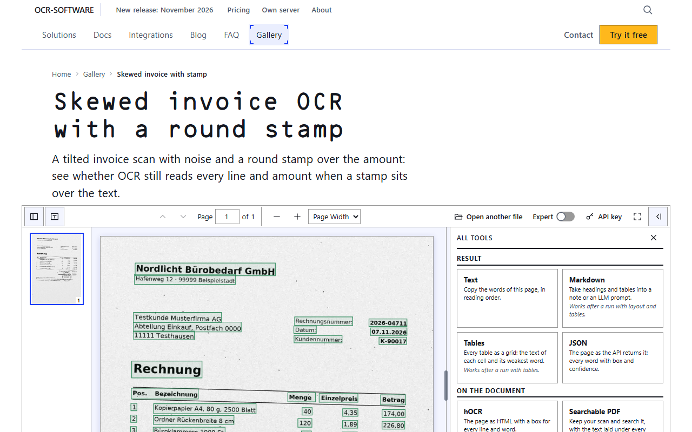
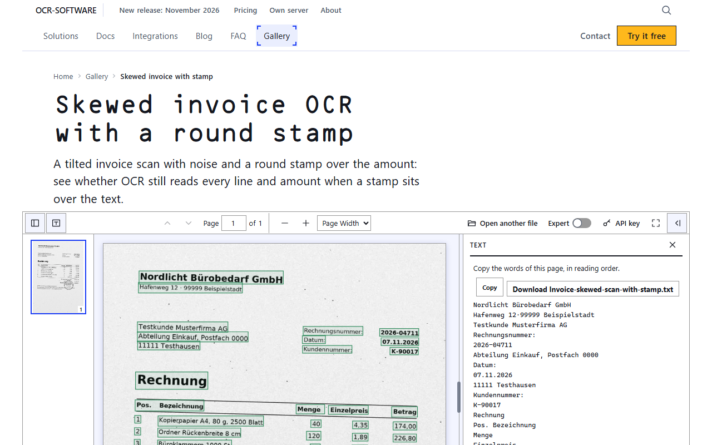
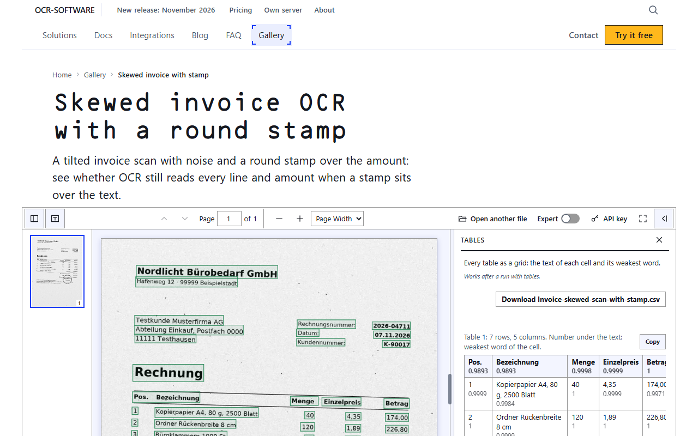
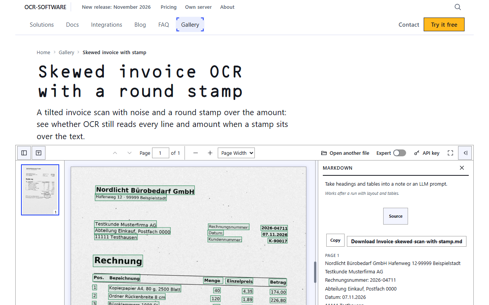
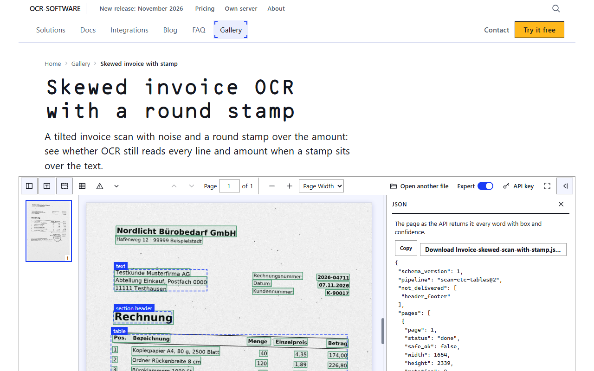
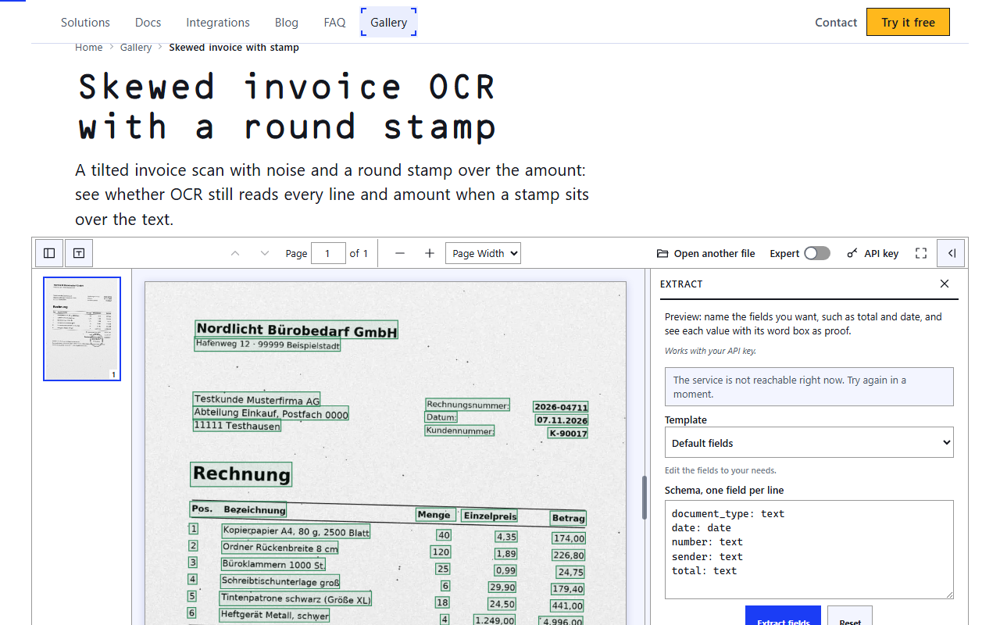
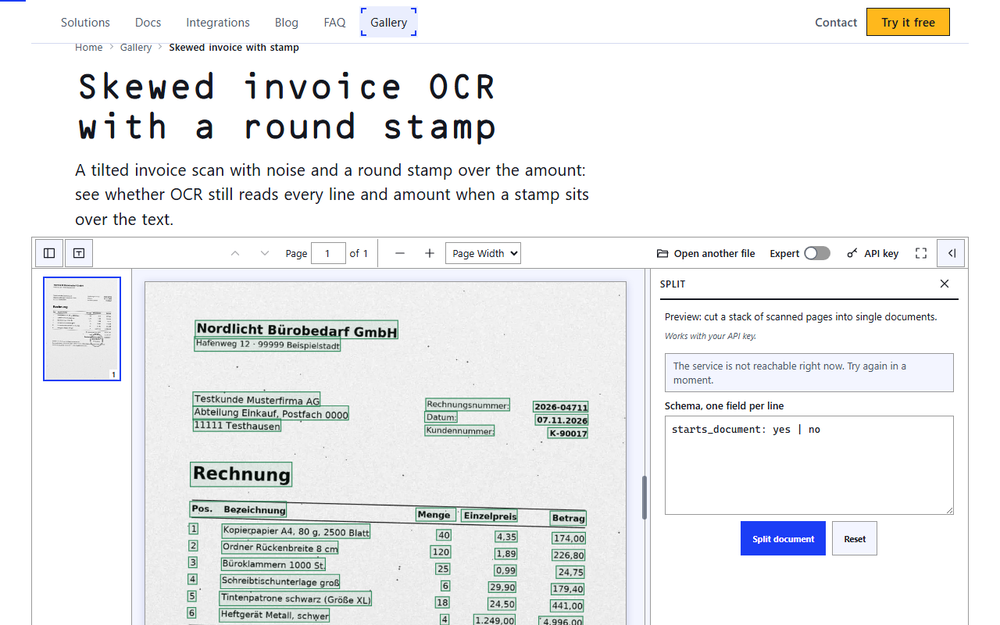
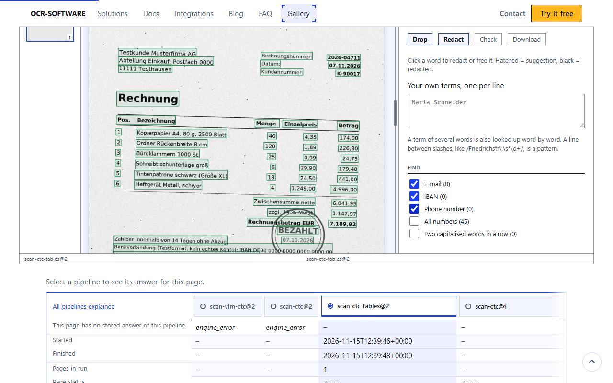

# OCR viewer: word boxes, confidence and layout for OCR results, in any web page

Every word of an OCR result in its box on the page image, with its confidence, the tables and the layout. One JavaScript file, one CSS file, no other library. For results from the [ocr-software.com](https://ocr-software.com/) API, hosted or on your own server.

**[Open the live viewer](https://ocr-software.com/app/)**: drop a PDF or photo, one page is free without a key.



## Tools

The viewer ships as the one file `ocr-viewer.js`; there are no separate `.js` files to look for. Inside it, each part starts with a comment like `/* ---- derive.js ---- */`, the name of the source part it was built from. Search the file for that comment to find a tool's code.

| Tool | What it does | Search `ocr-viewer.js` for |
|---|---|---|
| <br>Page | The page with a box for every word, zoom, thumbnails | `---- stage.js ----`, `---- geometry.js ----` |
| <br>Text | The words of the page in reading order, to copy | `---- derive.js ----` |
| <br>Tables | Every table as a grid, the weakest word of each cell, CSV | `---- resultview.js ----` |
| <br>Markdown | Headings and tables as Markdown, for a note or an LLM prompt | `---- derive.js ----` |
| <br>JSON | The page as the API returns it; a click on a word finds its place | `---- jsonview.js ----` |
| <br>Extract | Fields from a schema, each value with its word boxes as proof (preview) | `---- extract.js ----`, `---- schemaedit.js ----` |
| <br>Split | A PDF cut into documents, as PDF or ZIP (preview) | `---- split.js ----` |
| <br>Redact | Find names and numbers, black them out, save a PDF of page pictures | `---- find.js ----` |

## Use it

Embed a result you fetched yourself. The viewer does not read documents in this mode.

```html
<link rel="stylesheet" href="ocr-viewer.css"><div id="v"></div><script src="ocr-viewer.js"></script>
<script>OcrViewer.mount(document.getElementById("v"), {result: "result.json", image: "page.png"});</script>
```

Or mount the whole viewer, with file choice and reading: `OcrViewer.mount(el, {api: "https://api.ocr-software.com"})`.

Serve this folder over http (`python -m http.server`) and open `example.html`; a browser does not load the JSON files from `file://`. Get a result with the [API guide](https://ocr-software.com/docs/api-guide/). A key is free: [get one](https://ocr-software.com/order/). Keep it out of public pages: fetch the result on your server and hand the viewer the JSON.

Your own server answers the same calls: swap the address, the viewer shows the result unchanged ([install](https://ocr-software.com/docs/install/)).

## Add a tool

1. Decide what the tool needs. `GET https://api.ocr-software.com/v1/catalog` lists the capabilities of each pipeline (`word_boxes`, `layout_classes`, `table_cells` ...). Name one as the capability of the tool, and the viewer says "Works after a run with ..." on its card by itself.
2. Look at the data you get: the result fields are in [`openapi.json`](https://api.ocr-software.com/openapi.json) and on the [API reference](https://ocr-software.com/docs/reference/).
3. In `ocr-viewer.js`, add one sentence for the card to `CARD_TEXT` (section `strings.js`).
4. In the section `viewer.js`, add `card('mytool', 'word_boxes', 'My tool', myView)` to a group of cards, and write `myView`: it calls `openPanel('mytool', 'My tool', needs, ...nodes)` with the elements to show.
5. Reload `example.html` and click your card.

## Issues and pull requests

Issues are welcome now: a bug, a result shown wrongly, a missing tool. Attach the result JSON without personal data, or say what the page looked like. Pull requests are accepted as soon as the contributor license agreement (CLA) is ready; until then please open an issue.

## License

AGPL-3.0, see `LICENSE`. Use it as it is, or change it for your own use, and you owe nothing. Change it and offer it to others, or build it into a product, and the changes go public under the same license. [Ask for a commercial license](https://ocr-software.com/contact/).

## Provider and legal

The service is operated by Helm & Nagel GmbH. [Terms](https://ocr-software.com/legal/saas-terms/) · [Privacy](https://ocr-software.com/legal/privacy/) · [Imprint](https://ocr-software.com/legal/imprint/) · [Security](https://ocr-software.com/legal/security/)
